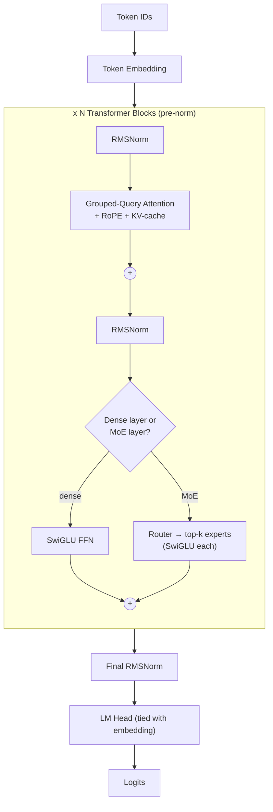

# Modern Transformer

A clean, from-scratch implementation of a **modern decoder-only Transformer** in pure PyTorch — the same architectural recipe used by LLaMA, Mistral and Mixtral — with a complete training and generation pipeline. Readable enough to learn from, complete enough to actually train.


## Features

| Component | Implementation |
|---|---|
| **Positional encoding** | Rotary Position Embeddings (RoPE) |
| **Attention** | Grouped-Query Attention (MHA / GQA / MQA via `n_kv_heads`), fused `scaled_dot_product_attention` (FlashAttention when available) |
| **Local attention** | Optional sliding-window attention |
| **Normalisation** | Pre-norm RMSNorm |
| **Feed-forward** | SwiGLU |
| **Sparse scaling** | Optional top-k Mixture-of-Experts with Switch-style load-balancing loss |
| **Inference** | KV-cache, greedy / temperature / top-k / top-p sampling, repetition penalty, padding masks |
| **Training** | AdamW with selective weight decay, warmup + cosine LR, grad accumulation & clipping, bf16/fp16 autocast, gradient checkpointing, `torch.compile`, resumable checkpoints |
| **Extras** | Weight tying, depth-scaled init, dependency-free byte tokenizer, JSON configs, pytest suite, GitHub Actions CI |

## Architecture



```
x ──► RMSNorm ──► GQA(RoPE) ──► (+) ──► RMSNorm ──► SwiGLU / MoE ──► (+) ──► out
│                               ▲  │                                  ▲
└───────── residual ────────────┘  └────────── residual ──────────────┘
```

## Installation

```bash
git clone https://github.com/<your-username>/modern-transformer.git
cd modern-transformer
python -m venv .venv && source .venv/bin/activate   # optional
pip install -e ".[dev]"
```

## Quick start

```python
import torch
from modern_transformer import Transformer, TransformerConfig

cfg = TransformerConfig(
    vocab_size=259, max_seq_len=512,
    d_model=256, n_layers=6, n_heads=8, n_kv_heads=2,   # GQA: 4 query heads per KV head
    use_moe=True, n_experts=4, moe_top_k=2,             # every 2nd layer is an MoE layer
)
model = Transformer(cfg)
print(f"{model.num_parameters() / 1e6:.1f}M parameters")

x = torch.randint(0, cfg.vocab_size, (2, 128))
out = model(x, targets=x)          # targets are aligned with inputs (no internal shift)
print(out.loss, out.lm_loss, out.aux_loss)

# Generation with KV-cache
tokens = model.generate(x[:, :16], max_new_tokens=50, temperature=0.8, top_p=0.9)
```

## Training

Any plain-text file works (a byte-level tokenizer is used, so there are no extra downloads):

```bash
# 1. Get some data (Tiny Shakespeare)
curl -L -o data/input.txt https://raw.githubusercontent.com/karpathy/char-rnn/master/data/tinyshakespeare/input.txt

# 2. Train a small model (runs on CPU; much faster on GPU)
python scripts/train.py --data data/input.txt --config configs/tiny.json --max_steps 2000

# 3. Train the Mixture-of-Experts variant
python scripts/train.py --data data/input.txt --config configs/small_moe.json --batch_size 16 --compile

# Resume
python scripts/train.py --data data/input.txt --resume checkpoints/last.pt --max_steps 5000
```

## Generation

```bash
python scripts/generate.py --checkpoint checkpoints/best.pt \
    --prompt "ROMEO:" --max_new_tokens 400 --temperature 0.8 --top_p 0.9
```

## Configuration

All options live in `TransformerConfig` (`src/modern_transformer/config.py`) and can be loaded from JSON (see `configs/`).

| Field | Default | Description |
|---|---|---|
| `vocab_size` | 259 | Vocabulary size (256 bytes + PAD/BOS/EOS) |
| `max_seq_len` | 1024 | Maximum context length (RoPE cache size) |
| `d_model` | 512 | Hidden size |
| `n_layers` | 8 | Number of blocks |
| `n_heads` | 8 | Query heads |
| `n_kv_heads` | 4 | KV heads (`1` = MQA, `n_heads` = MHA) |
| `ffn_mult` | 8/3 | FFN hidden = `ffn_mult * d_model`, rounded to `multiple_of` |
| `rope_theta` | 10000 | RoPE base frequency |
| `dropout` | 0.0 | Dropout on residual branches & attention |
| `sliding_window` | `None` | Local attention window size |
| `use_moe` | False | Enable Mixture-of-Experts layers |
| `moe_every` | 2 | Every n-th layer is MoE |
| `n_experts` / `moe_top_k` | 8 / 2 | Experts per MoE layer / experts per token |
| `moe_aux_loss_coef` | 0.01 | Load-balancing loss weight |
| `tie_embeddings` | True | Share input/output embeddings |
| `gradient_checkpointing` | False | Trade compute for memory during training |

Preset configs: `tiny.json` (~1M params), `small_moe.json`, `base.json` (~100M params).

## Project structure

```
modern-transformer/
├── src/modern_transformer/
│   ├── config.py          # TransformerConfig dataclass (+ validation, JSON I/O)
│   ├── model.py           # Transformer LM, loss, optimizer setup
│   ├── block.py           # Pre-norm transformer block
│   ├── generation.py      # KV-cache sampling (top-k / top-p / repetition penalty)
│   ├── tokenizer.py       # Byte-level tokenizer
│   └── layers/
│       ├── norm.py        # RMSNorm
│       ├── rope.py        # Rotary embeddings
│       ├── attention.py   # Grouped-query attention, masks, KV-cache
│       ├── feedforward.py # SwiGLU
│       └── moe.py         # Mixture-of-Experts + load-balancing loss
├── scripts/               # train.py, generate.py, count_params.py
├── configs/               # JSON model presets
├── tests/                 # pytest suite
├── .github/workflows/     # CI
└── pyproject.toml
```

## Testing

```bash
pytest -q
```

The suite checks, among other things: **causality** (future tokens never affect past logits), **KV-cache equivalence** with a full forward pass (with and without sliding window), RoPE's relative-position property, MoE routing and gradient flow, weight tying, gradient-checkpointing parity, padding-mask safety, and config validation.

## Design notes

- **KV-cache stores compact tensors** (`n_kv_heads`), expanded only at compute time — this is the memory saving that makes GQA worthwhile at inference.
- **Targets are pre-aligned** with inputs (`targets[:, i]` is the token after `input_ids[:, i]`), nanoGPT-style.
- **MoE routing** is implemented with a simple per-expert loop for clarity; for production throughput, replace it with a fused grouped-GEMM kernel.
- **Sliding-window caching** keeps the full cache and masks it; trimming the cache to the window is a straightforward optimisation.

## Roadmap

- [ ] Expert capacity limits / expert-parallel routing
- [ ] Rolling (trimmed) KV-cache for sliding-window attention
- [ ] RoPE scaling (NTK / YaRN) for long-context extension
- [ ] BPE / SentencePiece tokenizer integration
- [ ] Multi-GPU training (DDP / FSDP)

## References

- Vaswani et al., *Attention Is All You Need* (2017)
- Su et al., *RoFormer: Enhanced Transformer with Rotary Position Embedding* (2021)
- Ainslie et al., *GQA: Training Generalized Multi-Query Transformer Models* (2023)
- Shazeer, *GLU Variants Improve Transformer* (2020)
- Zhang & Sennrich, *Root Mean Square Layer Normalization* (2019)
- Fedus et al., *Switch Transformers* (2021); Jiang et al., *Mixtral of Experts* (2024)
- Touvron et al., *LLaMA* (2023)

## License

MIT — see [LICENSE](LICENSE).
