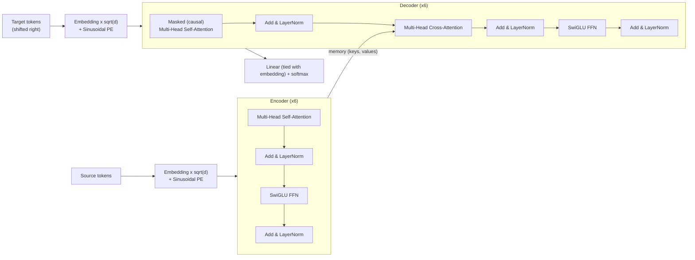

# Attention Is All You Need — PyTorch Implementation

A from-scratch implementation of the **encoder-decoder Transformer** from [*Attention Is All You Need*](https://arxiv.org/abs/1706.03762) (Vaswani et al., 2017) in pure PyTorch, with a full sequence-to-sequence training pipeline. Every component — scaled dot-product attention, multi-head attention, positional encoding, masking, cross-attention — is written out explicitly (no `nn.Transformer`, no fused attention kernels) so the code reads like the paper.


## Architecture

Default configuration: **6 encoder layers, 6 decoder layers, 8 attention heads, d_model = 512**, SwiGLU feed-forward networks.



### What follows the paper, and what doesn't

| Component | This repo | Paper |
|---|---|---|
| Layers / heads / d_model | 6 + 6 / 8 / 512 | same |
| Attention | explicit `softmax(QKᵀ/√d_k)V`, multi-head | same |
| Positional encoding | sinusoidal | same |
| Masking | padding mask + causal mask | same |
| Residuals + LayerNorm | post-LN (`norm_first=True` for pre-LN) | post-LN |
| Embeddings | scaled by √d_model, output projection tied to target embedding | same |
| Label smoothing | 0.1 | 0.1 |
| LR schedule | Noam warmup/inverse-sqrt (`--scheduler noam`) or warmup + cosine | Noam |
| **Feed-forward** | **SwiGLU** (hidden = ⅔·d_ff so params match) — `ffn_type="relu"` for the original | ReLU |
| **Optimizer** | **AdamW** (β=(0.9, 0.98), ε=1e-9, decoupled weight decay) | Adam |

## Installation

```bash
git clone https://github.com/<your-username>/attention-is-all-you-need.git
cd attention-is-all-you-need
python -m venv .venv && source .venv/bin/activate   # optional
pip install -e ".[dev]"
```

## Quick start

```python
import torch
from seq2seq_transformer import Transformer, TransformerConfig, greedy_decode

cfg = TransformerConfig(src_vocab_size=1000, tgt_vocab_size=1000)  # 6+6 layers, 8 heads, d_model=512
model = Transformer(cfg)
print(f"{model.num_parameters() / 1e6:.1f}M parameters")

src    = torch.randint(4, 1000, (2, 12))               # (B, S)
tgt_in = torch.randint(4, 1000, (2, 10))               # (B, T)  = [BOS] + target tokens
logits = model(src, tgt_in)                            # (B, T, vocab) — teacher forcing

generated = greedy_decode(model, src, max_len=20)      # autoregressive inference
```

## Training

Teacher forcing: the decoder receives `[BOS] + target` and is trained to predict `target + [EOS]` with cross-entropy (label smoothing 0.1, padding ignored).

**1. Synthetic tasks — no downloads, good for verifying the model learns**

```bash
python scripts/train.py --task reverse --config configs/tiny.json --epochs 15   # also: copy, sort
python scripts/infer.py --checkpoint checkpoints/best.pt --input "5 9 3 12 7"
```

Prints per-epoch train/val loss, perplexity, learning rate and sequence-level exact-match accuracy.

**2. Real parallel text** — a tab-separated file with `source<TAB>target` per line. For example the Tatoeba/Anki pairs from <https://www.manythings.org/anki/> (extra columns are ignored):

```bash
python scripts/train.py --task text --data data/fra.txt --config configs/tiny.json \
    --max_pairs 50000 --epochs 20 --batch_size 64
python scripts/infer.py --checkpoint checkpoints/best.pt --input "Go home."
```

A character-level tokenizer is used so there is nothing extra to install. For serious translation quality, swap in a BPE/SentencePiece tokenizer and update the vocab sizes.

**3. Paper-style learning-rate schedule**

```bash
python scripts/train.py --task reverse --scheduler noam --warmup_steps 4000 --epochs 40
```

Useful flags: `--config configs/base.json` (full 6+6 / 512 model), `--amp` (bf16 on CUDA), `--label_smoothing`, `--grad_clip`, `--weight_decay`.

## Project structure

```
attention-is-all-you-need/
├── src/seq2seq_transformer/
│   ├── attention.py     # scaled_dot_product_attention + MultiHeadAttention
│   ├── embeddings.py    # scaled token embedding + sinusoidal positional encoding
│   ├── feedforward.py   # SwiGLU (default) and ReLU FFN
│   ├── encoder.py       # EncoderLayer / Encoder
│   ├── decoder.py       # DecoderLayer (self-attn, cross-attn, FFN) / Decoder
│   ├── model.py         # Transformer (encode / decode / forward, optimizer setup)
│   ├── masks.py         # padding + causal masks
│   ├── scheduler.py     # Noam and warmup-cosine LR schedules
│   ├── decoding.py      # greedy decoding
│   ├── data.py          # synthetic tasks, parallel-text dataset, collator
│   ├── tokenizer.py     # character-level tokenizer
│   └── config.py        # TransformerConfig
├── scripts/             # train.py, infer.py, count_params.py
├── configs/             # base.json (paper size), tiny.json
├── tests/               # pytest suite
└── .github/workflows/   # CI
```

## Tests

```bash
pytest -q
```

The suite checks: attention against PyTorch's reference implementation, attention-weight normalisation and masking, **decoder causality** (future target tokens never influence earlier outputs), **cross-attention dependence on the source**, **source-padding invariance**, sinusoidal-encoding values, post-LN/pre-LN and SwiGLU/ReLU variants, weight tying, teacher-forcing tensor layout, LR-schedule shapes, config validation, greedy decoding, and that a tiny model can **overfit a batch** (loss drops >70%).

## Possible extensions

- [ ] Beam search with length penalty
- [ ] KV-cache for incremental decoding
- [ ] BPE / SentencePiece tokenization and BLEU evaluation
- [ ] Multi-GPU training (DDP)

## Reference

Vaswani, A., Shazeer, N., Parmar, N., Uszkoreit, J., Jones, L., Gomez, A. N., Kaiser, Ł., & Polosukhin, I. (2017). *Attention Is All You Need.* NeurIPS. <https://arxiv.org/abs/1706.03762>

SwiGLU: Shazeer, N. (2020). *GLU Variants Improve Transformer.* <https://arxiv.org/abs/2002.05202>

## License

MIT — see [LICENSE](LICENSE).
